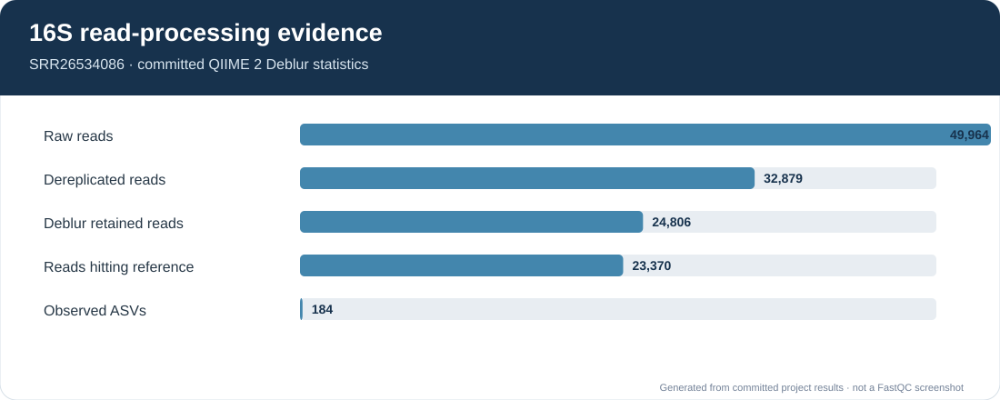
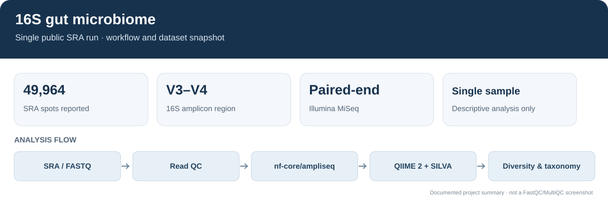
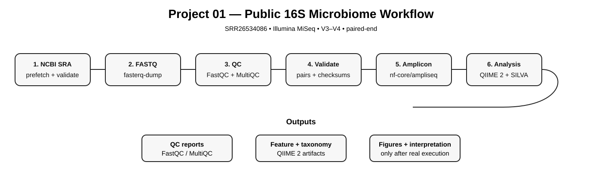
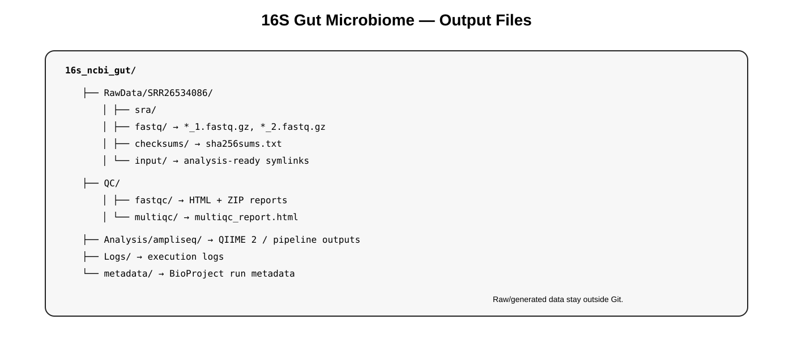

# 16S rRNA Gut Microbiome Profiling

## Read-processing evidence

The figure below summarizes the committed QIIME 2 Deblur statistics for the single public run. It is a data-derived summary, not a FastQC report.

## Overview figure

End-to-end 16S rRNA amplicon workflow using a public NCBI SRA human stool run.

## Two execution paths

The local workflow in `scripts/01_download_ncbi.sh` through `scripts/05_run_ampliseq.sh` runs nf-core/ampliseq with the tracked parameter settings. The checked-in `results/` report is a compact example produced by the QIIME 2 Cutadapt + Deblur route, which trims to 200 bp. The GitHub Actions workflow reruns that route and uploads the fresh output as the `project01-16s-results` artifact; it does not commit generated files back to the repository. These are separate runs with different processing settings, so their outputs should not be treated as interchangeable.

## Dataset

- SRA: SRR26534086
- BioSample: SAMN37943185
- BioProject: PRJNA1031545
- Experiment: SRX22237515
- Platform: Illumina MiSeq
- Layout: paired-end
- Region: V3–V4
- Primers: CCTACGGGNGGCWGCAG / GACTACHVGGGTATCTAATCC

NCBI reports 49,964 spots, 22.5M bases and about 13.1 MB for this run. The parent study contains stool 16S data from 77 STEMI patients. This single run is for workflow learning and validation, not group-level inference.

## Workflow

NCBI SRA → download → vdb-validate → FASTQ → FastQC → MultiQC → paired-read validation → nf-core/ampliseq + Docker → DADA2/QIIME 2/SILVA → downstream diversity → interpretation.

## Local data

Keep downloaded reads and intermediate files in a local data directory outside the repository. Set `DATA_ROOT` to that directory before running the scripts; the workflow should not depend on a machine-specific path or on company storage.

## Run order

1. bash scripts/00_setup.sh
2. bash scripts/01_download_ncbi.sh
3. bash scripts/02_qc.sh
4. bash scripts/03_validate.sh
5. bash scripts/04_prepare_input.sh
6. bash scripts/05_run_ampliseq.sh
7. bash scripts/05_qiime2_downstream.sh
8. bash scripts/06_expand_bioproject.sh

Read the MultiQC report before changing trimming parameters. The parameter file preserves the V3–V4 setup documented in the supplied workflow: truncation 280/260, SILVA taxonomy, Docker and nf-core/ampliseq 2.11.0.

## Repository structure

README.md
├── docs/
├── metadata/
├── params/
├── scripts/
└── logs/

Raw FASTQ/SRA files, QIIME 2 artifacts, Nextflow work directories and generated logs stay outside Git.

## Figures

See [Outcomes and Deliverables](docs/OUTCOMES.md) for the expected outputs and the rules for adding real biological results.

## Documentation

- [Quickstart](docs/QUICKSTART.md) — execute the workflow step by step
- [Workflow](docs/WORKFLOW.md) — computational design and provenance
- [Data provenance](docs/DATA_PROVENANCE.md) — accession and sequencing context
- [Troubleshooting](docs/TROUBLESHOOTING.md) — common SRA, Java, Docker, Nextflow and memory failures
- [Interpretation](docs/INTERPRETATION.md) — what can and cannot be concluded

## Interpretation

One sample can demonstrate read quality, feature generation, taxonomy and descriptive diversity. It cannot establish differential abundance, disease association or cohort-level biological conclusions.