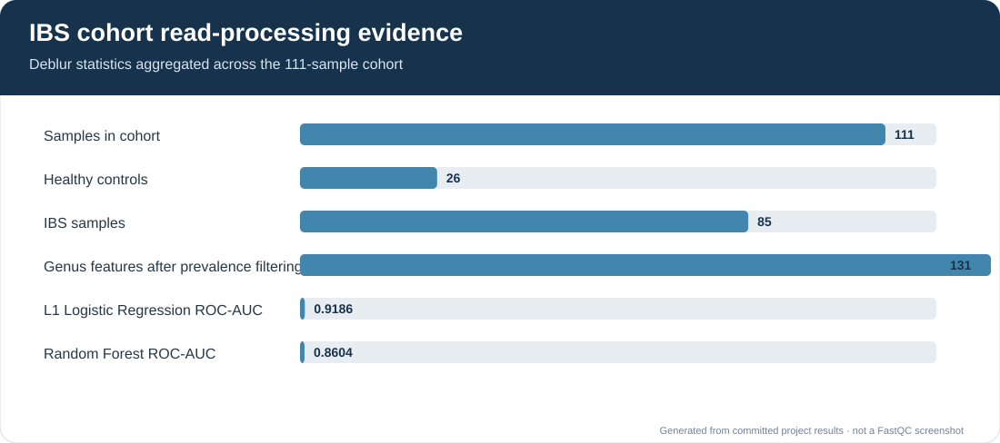
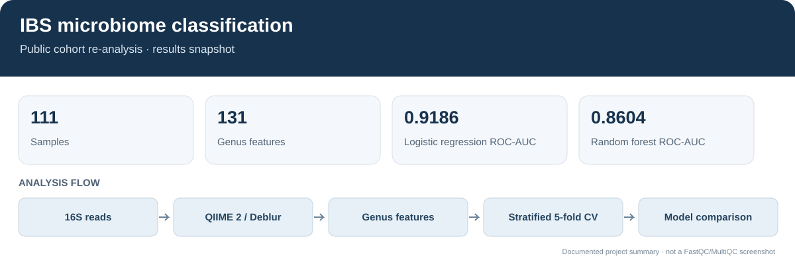
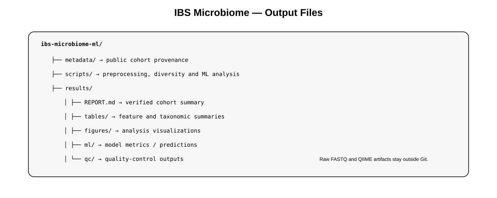

# IBS Microbiome Analysis and Machine Learning

## Analysis evidence

The figure summarizes the cohort size, genus-level feature count, and cross-validation metrics recorded in the project outputs. The read-processing statistics are available in `results/qc/deblur-stats/stats.csv`.

## Overview figure

Public-data-only cohort analysis using PRJNA637763, a human gut 16S rRNA dataset containing 85 IBS samples and 26 healthy controls. The study used V1–V2 amplicon sequencing on Illumina MiSeq and was explicitly designed for microbiome-based IBS prediction.

## Workflow figure

## Objectives
1. Build a 16S feature table from public SRA/ENA reads.
2. Summarize alpha diversity and taxonomic composition.
3. Compare IBS and healthy-control samples descriptively.
4. Evaluate genus-level classifiers with stratified cross-validation.
5. Record the model metrics and ranked genera.

## Analysis
- Public source: NCBI BioProject PRJNA637763
- Study: Usefulness of Machine Learning-Based Gut Microbiome Analysis for Identifying Patients with Irritable Bowels Syndrome
- Samples: 85 IBS + 26 healthy controls
- Region: V1–V2
- Platform: Illumina MiSeq, paired-end
- Denoising: QIIME 2 Deblur on forward reads
- Taxonomy: SILVA 138 99% classifier
- ML: scikit-learn logistic regression and random forest with stratified cross-validation

This is an independent re-analysis of public data, not a reproduction of the original paper's exact preprocessing or model. Genus prevalence filtering is currently done before cross-validation, so the reported scores should be treated as exploratory rather than as a fully nested validation estimate.

## Outputs
- results/REPORT.md
- results/tables/
- results/figures/
- results/ml/
- results/qc/

Raw FASTQ and intermediate QIIME artifacts are intentionally not committed.
