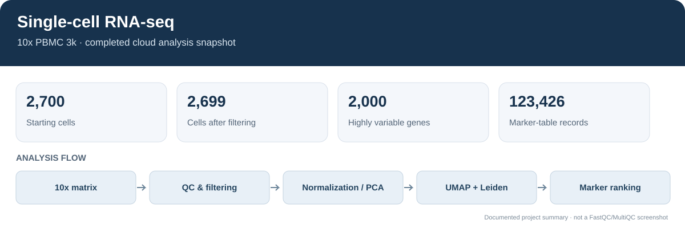

# Project 08 — Single-Cell RNA-seq Analysis

## Overview figure


I used the public 10x Genomics PBMC 3k dataset to explore gene-expression patterns in peripheral blood mononuclear cells. The analysis was run in GitHub Actions, so it did not depend on my local machine.

## What I did

- Downloaded and checked the filtered gene-expression matrix.
- Looked at basic cell and gene quality metrics and filtered low-quality entries.
- Normalized the counts and selected highly variable genes.
- Used PCA, a neighbour graph and UMAP to explore the data.
- Grouped cells with Leiden clustering and ranked marker genes for each cluster.
- Saved the processed data, tables and plots as workflow outputs.

## Dataset

- **Dataset:** 3k PBMCs from a healthy donor
- **Source:** [10x Genomics](https://www.10xgenomics.com/datasets/3-k-pbm-cells-from-a-healthy-donor-1-standard-1-1-0)
- **Reference:** hg19
- **Tools:** Python, Scanpy, AnnData and GitHub Actions

## Results

The cloud run started with **2,700 cells and 32,738 genes**. After filtering, **2,699 cells and 13,714 genes** remained. The analysis selected **2,000 highly variable genes** and produced a marker-gene table with **123,426 records**.

The run completed successfully in [GitHub Actions](https://github.com/Ashoka24/Bioinformatics/actions/runs/38929166318). The workflow uploaded an artifact containing the processed AnnData file, QC metrics, marker tables, cluster annotations, run metadata and plots.

## How to run it again

The workflow can be run through GitHub Actions, or locally with Python 3.10 or 3.11:

```bash
python -m venv .venv
# Windows: .venv\Scripts\activate
# macOS/Linux: source .venv/bin/activate
python -m pip install --upgrade pip
pip install -r requirements.txt
python scripts/download_data.py
python scripts/validate_inputs.py --input data/raw/filtered_gene_bc_matrices/hg19
python scripts/run_analysis.py --config config/analysis.json --input data/raw/filtered_gene_bc_matrices/hg19 --output results
```

These commands are included so the analysis can be reproduced; the results above are from the completed GitHub Actions run.

## Outputs

The workflow artifact includes:

- `qc_metrics.csv`
- `highly_variable_genes.csv`
- `marker_genes.csv`
- `cluster_annotations.csv`
- `pbmc3k_processed.h5ad`
- `run_metadata.json`
- QC, UMAP and canonical-marker plots

Generated results and the raw dataset are kept out of the Git repository. The workflow artifact is available for a limited time, so rerun the workflow if it has expired.

## A few things to keep in mind

The cluster labels are preliminary and should be checked against known marker genes and suitable references. UMAP is useful for visualizing patterns, but it does not prove that clusters are biologically distinct. This dataset comes from one healthy donor, so individual cells should not be treated as independent biological replicates for population-level conclusions. This is an exploratory analysis, not a clinical diagnostic tool.

## References

- [10x Genomics PBMC 3k dataset](https://www.10xgenomics.com/datasets/3-k-pbm-cells-from-a-healthy-donor-1-standard-1-1-0)
- [Scanpy documentation](https://scanpy.readthedocs.io/)
- [AnnData documentation](https://anndata.readthedocs.io/)
